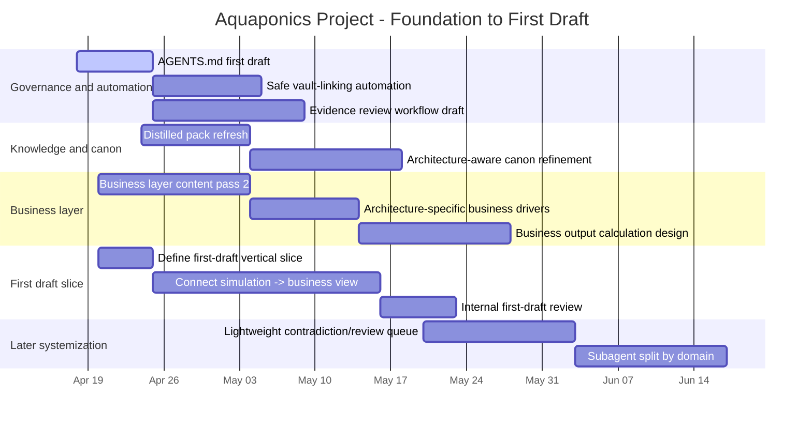

# Project Status and Roadmap

_Last updated: 2026-04-18_

## 1. Purpose of this document

This document summarizes the current state of the Aquaponics project, the major foundations already completed, the highest-priority gaps still remaining, and the intended path toward a coherent first internal draft.

It is a planning document, not a strict technical contract. Canonical machine-readable truth remains in `data/knowledge/**`, while `data/simulation/**` remains derived runtime output.

## 2. Current focus

The current priority is to move forward from repo cleanup into bounded, high-leverage progress.

Current focus areas:

- stabilize safe automation and agent rules
- strengthen the business-layer foundation
- define the first coherent vertical slice
- avoid reopening settled plumbing or boundary work unless a real failure appears

## 3. What we have built so far

### Knowledge and evidence foundation

- The canonical-vs-derived boundary is now clear:
  - `data/knowledge/**` = canonical
  - `data/simulation/**` = derived runtime
- A core Layer 1 evidence base is in place, including:
  - species reports for tilapia, lettuce, and basil
  - water chemistry and pH management
  - biofilters and solids filters
  - pumps and aeration
  - media bed vs DWC vs NFT architecture evidence
  - trusted-source / trust-policy guidance
  - a distilled research pack

### Canonical repo improvements completed

- Species context-only refinements were applied without breaking consumed field contracts.
- Targeted runtime/build tests passed after the tilapia snapshot fixture was corrected.
- The first-pass business-layer foundation was added:
  - `docs/business_layer_contract.md`
  - `docs/business_layer_plan.md`
  - `data/knowledge/business/**`
- Business-layer provenance and deferred-path cleanup was completed.
- `.gitignore` was updated so canonical business-layer knowledge is versioned correctly.

### Knowledge-vault improvements completed

- Obsidian churn was reduced.
- `Component Library.md` was linked into the component hub.
- A bounded automated vault-linking pass was tested successfully.
- The tested pass added minimal hub links without touching `.obsidian/**`.

## 4. Current progress snapshot

These are rough planning judgments used for prioritization, not exact measurements.

| Area | Approx. status | Why it is here |
|---|---:|---|
| Knowledge / evidence foundation | 90% | Strong evidence stack, trust policy is clear, and the core canonical direction is mostly stabilized |
| Runtime / repo-boundary stability | 85% | Canonical vs derived separation is now stable and targeted checks are passing |
| Business-layer foundation | 80% | First-pass canonical business layer exists and has already had an initial cleanup pass |
| Knowledge-vault / Obsidian navigation | 75% | Main churn is cleaned up and the first successful bounded linking pass has been tested |
| Agent-readiness | 45% | Good enough for bounded review-first automation, not yet ready for heavy multi-agent orchestration |
| Overall foundation readiness | 80% | The project is past the major plumbing/confusion phase and is ready for more focused forward work |

## 5. What is still missing

### Evidence-to-canon refinement still remaining

- Refresh the Distilled Research Pack against the latest upload set.
- Align distilled recommendations to `data/knowledge/**` first rather than `data/simulation/**`.
- Incorporate architecture-specific differences (media bed vs DWC vs NFT) into canonical interpretation more explicitly.
- Make evidence scoring, contradiction tickets, and review flow more repeatable.

### Workflow and governance still remaining

- A lightweight contradiction / review queue workflow
- More consistent source-registry and evidence-review discipline
- Stable agent operating rules that are safe enough for repeated use
- Clearer domain-specific automation boundaries before broader agent use

### Later integration work still remaining

- A knowledge-to-runtime-to-business mapping contract
- A calculation layer for business outputs
- A scenario-comparison layer
- A first coherent end-to-end draft slice
- A reviewable simulation -> business interpretation -> reporting path

## 6. Best next steps

### Immediate

1. Stabilize `AGENTS.md` and safe automation rules
2. Strengthen business-layer content with architecture-specific business drivers
3. Define the first-draft vertical slice clearly
4. Continue review-first vault-linking passes as low-risk maintenance work
5. Refresh the Distilled Research Pack later, after the current foundation work is steadier

### Near-term

6. Tighten the business layer with more evidence-backed business-driver structure
7. Start a lightweight contradiction / source-registry / review pipeline
8. Connect one coherent simulation -> business interpretation -> report flow
9. Prepare agent-ready review queues only after the operating rules are stable

### Later

10. Introduce domain-specific subagents only after the main workflows are repeatable
11. Expand scenario comparison once the first vertical slice is coherent
12. Grow from internal draft quality toward a shareable early version

## 7. First-draft target

The first draft should be a coherent vertical slice, not the whole product.

### Proposed first-draft target

A user can:

1. choose one starter architecture or starter system
2. run one starter scenario
3. see:
   - biological plausibility
   - operational warnings
   - architecture-specific trade-offs
   - business-layer interpretation
4. compare 2 to 3 variants side by side

### Suggested scope

- one starter fish/plant pairing
- one or two architecture types
- one narrow report/output view
- one business-evaluation path
- no broad production polish yet

## 8. Known non-goals for this phase

The current phase is not trying to deliver:

- full production-grade UI polish
- broad multi-agent orchestration
- complete market-calibrated economics
- full simulation/business integration across the repo
- generalized location-specific price, wage, or financing assumptions

## 9. Long-term goal

Long term, the system should support:

- a structured knowledge layer
- simulation-driven system behavior
- architecture-aware business interpretation
- agent/bot exploration of combinations and operating strategies
- comparison of which combinations perform best under defined goals

## 10. Modeling direction

### Recommended direction

Use:

- rule-based and state-based simulation
- architecture-specific constraints
- scenario comparison
- later, agents/bots choosing actions on top of that structure

### Not recommended as the core model yet

A Markov-chain-first design is not the best backbone right now.

Why:

- too little memory for delayed system effects
- weak fit for rich management interventions
- weak fit for accumulated solids, nutrient drift, maintenance lag, and staged crop/business timing

### Where Markov-like models may help later

- failure-state transitions
- maintenance state machines
- disease progression
- downtime / reliability states
- demand / channel state transitions

## 11. Timeline estimate

These are rough internal planning estimates, not commitments.

| Milestone | Rough timing |
|---|---|
| Better agent rules + safe automation base | 1–2 weeks |
| Stronger business-layer content pass | 1–3 weeks |
| First coherent internal draft / prototype | 4–8 weeks |
| Early externally shareable version | 3–6 months |

## 12. Gantt-style roadmap

Dates below are planning placeholders and should be updated if scope changes materially.

## 13. Rules for staying on track

- Do not reopen settled path or plumbing issues unless a real failure appears.
- Keep commits small and scoped.
- Prefer one bounded Codex or agent task over many tiny manual loops.
- Keep business-layer work and vault-linking work separate.
- Use automation experimentally first, then operationally.
- Prefer review-first workflows before apply/commit workflows.
- Treat `data/knowledge/**` as canonical and `data/simulation/**` as derived unless explicitly instructed otherwise.

## 14. Definition of success for the next phase

The next phase is succeeding if we can say:

- the repo has stable agent rules
- the vault-linking pass is repeatable and low-noise
- the business layer is more evidence-backed and architecture-aware
- the first-draft vertical slice is clearly defined
- integration work starts from a stable foundation instead of repo cleanup
