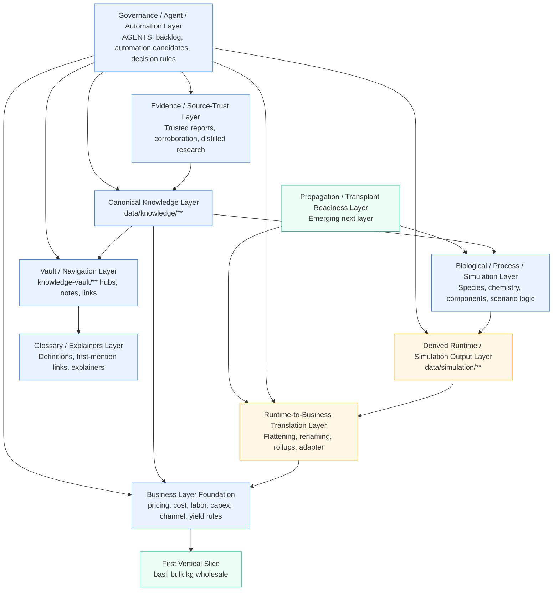

# Project Architecture Map — Visual

Status: `draft`

## Visual Map

## Boundary Rules

- `data/knowledge/**` = canonical
- `data/simulation/**` = derived runtime output
- `knowledge-vault/**` improves navigation and understanding, but does not override canon
- deferred business rules stay explicit rather than hidden
- repeated low-judgment checks should gradually move toward local Python helpers

## Reading Guide

- **Blue nodes** = strong current layers
- **Amber nodes** = weaker bridge/output layers that need more work
- **Green nodes** = next target / emerging layer

## Main Current Gap

The main bridge gap is the **Runtime-to-Business Translation Layer**.

This is where the project still needs:
- flattening and renaming from runtime fields into business-contract fields
- period framing
- one explicit source for `saleable_harvest_mass_kg`

## First Vertical Slice Target

Current best first slice:
- `basil bulk kg wholesale`

Why:
- direct-mass path is already the cleanest
- avoids head-count, bunch-count, timing-heavy, and architecture-advisory complexity
- matches the runtime-to-business audit direction
